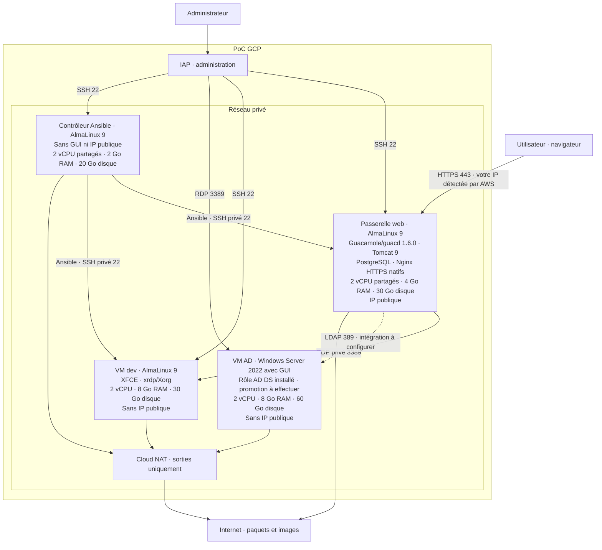

# Plateforme de vibe-coding

Environnement de développement accessible depuis un navigateur, avec le minimum de configuration pour l'utilisateur de la plateforme.

## Infrastructure fournie



## Déployer le PoC

Quatre ressources VM explicites dans `terraform/main.tf`, tailles et images en dur. Seule la gateway possède une IP publique éphémère ; AD, dev et le contrôleur restent privés. `network.tf` contient le VPC, sous-réseau, pare-feu et NAT pour les sorties des VM privées. Pas de création de comptes de service ni d'activation d'API par Terraform.

**Aucun conteneur** : les rôles maison de `ansible/` installent Guacamole, guacd, Tomcat, PostgreSQL et Nginx nativement, ainsi que XFCE/xrdp sur dev. Aucun rôle Galaxy. Aucun script de démarrage Linux ; seul AD conserve `terraform/scripts/ad.ps1`. Le contrôleur Ansible est préparé une fois manuellement en SSH via IAP.

Le préfixe des noms et tags est configurable avec `project_prefix` (exemple : `vibe-poc`, sans tiret final). Les commandes ci-dessous utilisent cet exemple.

Prérequis : Terraform ≥ 1.7, CLI `gcloud`, projet GCP facturé et droits Compute/réseau. Activer les API une fois :

```powershell
gcloud auth login
gcloud services enable compute.googleapis.com iap.googleapis.com oslogin.googleapis.com --project MON_PROJET
gcloud auth application-default login
cd terraform
Copy-Item terraform.tfvars.example terraform.tfvars
# Renseigner project_id, project_prefix, region et zone.
terraform init
terraform plan -out=poc.tfplan
terraform apply poc.tfplan
terraform output
```

Terraform provisionne les quatre VM et le réseau, et prépare Windows via son script. Suivre ensuite [le guide Ansible](ansible/README.md) pour préparer le contrôleur, enregistrer sa clé OS Login, transférer l'inventaire et configurer Linux avec `site.yml`.

**IP dynamique** : `local.my_ip` est récupérée via `https://checkip.amazonaws.com` à chaque nouveau plan et normalisée en réseau `/24` avec `cidrsubnet("${local.my_ip}/24", 0, 0)` pour HTTPS sur la gateway, SSH admin et RDP admin vers AD (ex. `203.0.113.10` → `203.0.113.0/24`). Ces règles autorisent tout le réseau, pas uniquement votre adresse. Après un changement de réseau de sortie, relancer `plan` puis `apply`. Un plan enregistré conserve le réseau du moment du plan ; ne pas réutiliser un ancien plan. Avec un VPN/proxy ou une CI, c'est leur IP de sortie qui est détectée. Les règles admin actuelles n'autorisent pas les relais IAP.

Pour basculer une infrastructure existante, examiner puis appliquer un **plan complet**, sans `-target`, pour retirer les IP publiques d'AD/dev/Ansible et limiter SSH aux relais IAP. Les dépendances Terraform des VM incluent leurs règles d'administration pour un provisionnement ciblé éventuel. Aucun changement n'est appliqué automatiquement par l'assistant.

## Première utilisation

- Guacamole : ouvrir `guacamole_url`, certificat auto-signé ; compte initial `guacadmin` / `guacadmin`, mot de passe à changer immédiatement.
- Dev : le rôle définit le mot de passe de `developer` depuis Ansible Vault (`ansible/vault/desktop_user.yml`, clé locale `.vault_password` exclue de Git). Voir [les fichiers Vault du PoC](ansible/README.md#2-mot-de-passe-desktop-avec-vault). Dans Guacamole : RDP vers `10.20.0.12:3389`, utilisateur `developer`, sécurité TLS, ignorer le certificat uniquement pour le PoC.
- AD : récupérer les identifiants et ouvrir un tunnel RDP IAP :

  ```powershell
  $zone = "europe-west9-a"
  $adVm = (terraform output -json vm_names | ConvertFrom-Json).ad
  gcloud compute reset-windows-password $adVm --project MON_PROJET --zone=$zone --user pocadmin
  gcloud compute start-iap-tunnel $adVm 3389 --local-host-port=localhost:13389 --project MON_PROJET --zone=$zone
  # Dans un autre terminal : mstsc /v:localhost:13389
  ```

  Si AD était déjà déployé en RDP direct, le redémarrer une fois après `apply` pour appliquer le nouveau pare-feu Windows. Le script désactive l'ancienne règle directe et limite RDP à IAP. Créer ensuite la forêt dans PowerShell administrateur : `Install-ADDSForest -DomainName "ad.vibe.test" -DomainNetbiosName "VIBE" -InstallDNS` (mot de passe DSRM interactif).

SSH utilise OS Login et une clé enregistrée pour votre identité ; les tunnels nécessitent `roles/iap.tunnelResourceAccessor`, la lecture Compute et OS Admin Login pour SSH. RDP utilise les identifiants Windows. Les pare-feu GCP limitent SSH d'administration et RDP AD aux relais IAP (`35.235.240.0/20`) ; l'accès SSH privé du contrôleur vers gateway/dev et le RDP privé Guacamole vers dev restent autorisés. LDAP/AD, OpenCode et VS Code restent à configurer ; Docker n'est installé nulle part. LDAP sur le port 389 n'est pas chiffré sans StartTLS.

Après les rôles : vérifier `sudo systemctl status guacd tomcat postgresql nginx` sur la gateway et `sudo systemctl status xrdp` sur dev. Logs applicatifs via `journalctl` et `/var/log/tomcat/` ; configuration dans `/etc/guacamole/`, données dans `/var/lib/pgsql/data/`.

Sans rôle préfait, le playbook principal reste court mais les 5 rôles totalisent **86 tâches**, surtout pour la base, Guacamole et SELinux/HTTPS. Firewalld est configuré avec les commandes natives via `ansible.builtin.command`, sans collection externe. C'est raisonnable pour le PoC, avec davantage de maintenance à notre charge. Aucun transfert automatique des données d'une ancienne installation ; utiliser des VM neuves ou prévoir une migration après sauvegarde.

L'IP publique éphémère de la gateway peut changer après arrêt/redémarrage : relire `terraform output vm_public_ips` après actualisation du state. Ne pas committer le state. Pas de sauvegarde automatique ; `terraform destroy` supprime aussi les données des VM.
